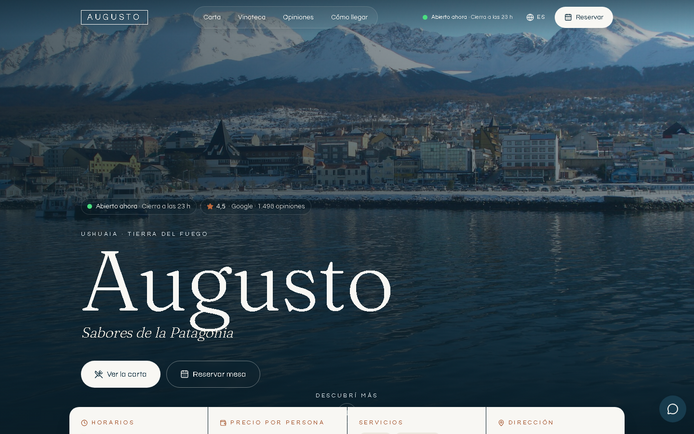
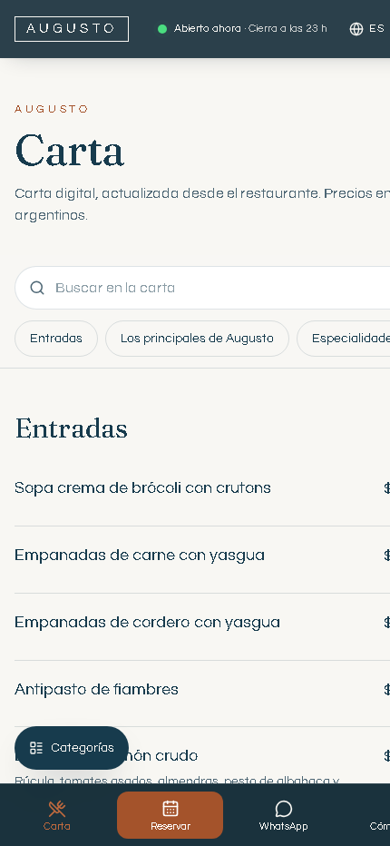
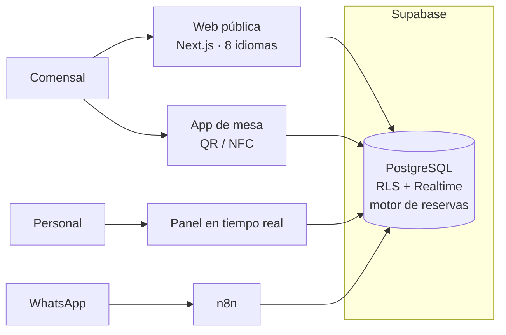

<h1 align="center">🍽️ Augusto Ushuaia</h1>

<b>Un restaurante del fin del mundo, con todo su servicio en una sola plataforma.</b> Web pública en 8 idiomas, carta digital, pedidos desde la mesa con QR y un motor de reservas.

  <a href="https://augusto-ushuaia.vercel.app"><b>🔗 Ver la web en vivo</b></a>

  
  
  
  
  
  
  
  

<table>
  <tr>
    <td></td>
    <td width="210"></td>
  </tr>
  <tr>
    <td align="center">Inicio</td>
    <td align="center">Carta digital en el celular</td>
  </tr>
</table>

> **Para ser claro:** es un prototipo personal y no oficial, inspirado en un restaurante de Ushuaia. No está vinculado al restaurante, nunca lo ofrecí ni lo vendí, y lo marcado como DEMO es de prueba.

## La idea

Ushuaia recibe turistas de todo el mundo, y un restaurante ahí necesita algo más que una página linda: que alguien de Corea o de Alemania pueda leer la carta en su idioma, reservar sin llamar por teléfono y pedir desde la mesa sin esperar al mozo para cada cosa. Quise juntar todo eso en una plataforma que el personal también pueda manejar en tiempo real.

## Qué hace

- 🌍 **Web pública en 8 idiomas** (español, inglés, portugués, alemán, italiano, chino, coreano y japonés), con horarios, ubicación con mapa y opiniones.
- 📖 **Carta digital** con buscador y categorías, actualizada desde el restaurante.
- 📱 **Pedidos desde la mesa con QR o NFC**: el pedido pasa primero por el mozo y el cliente ve el estado (recibido → en preparación → listo → entregado).
- 📅 **Motor de reservas** que usan la web y WhatsApp (y, más adelante, la voz) como única fuente de verdad.
- 🧑‍🍳 **Panel del personal** en tiempo real: carta, mesas, pedidos, reservas y equipo.
- 🥽 **Vista 3D/AR** de algunos platos, pidiendo permiso de cámara de forma explícita.

## Cómo está armado

## Decisiones de las que estoy orgulloso

- **Nunca se vende dos veces la misma mesa.** El motor de reservas usa bloqueos y una restricción de exclusión en PostgreSQL, así que aunque dos personas reserven en el mismo segundo, una sola gana. Lo pruebo con **60 verificaciones en SQL** y una prueba de concurrencia.
- **Reservas "en espera" de 5 minutos**, idempotencia y avisos con reintentos: si algo falla a mitad de camino, no queda una reserva fantasma.
- **El QR de la mesa nunca da acceso de administrador**, y las funciones que usa el bot están cerradas para el público.
- **Datos honestos**: lo que viene de fuentes verificadas del restaurante se marca así, y lo que no está confirmado se marca como DEMO.

## ¿Y el código?

El repositorio es privado porque el proyecto sigue en desarrollo. Lo muestro con gusto en una entrevista.

---

**Tomás Frem** · Tolhuin, Tierra del Fuego · [LinkedIn](https://www.linkedin.com/in/tomas-frem) · [Todos mis proyectos](https://github.com/ttom0001)
